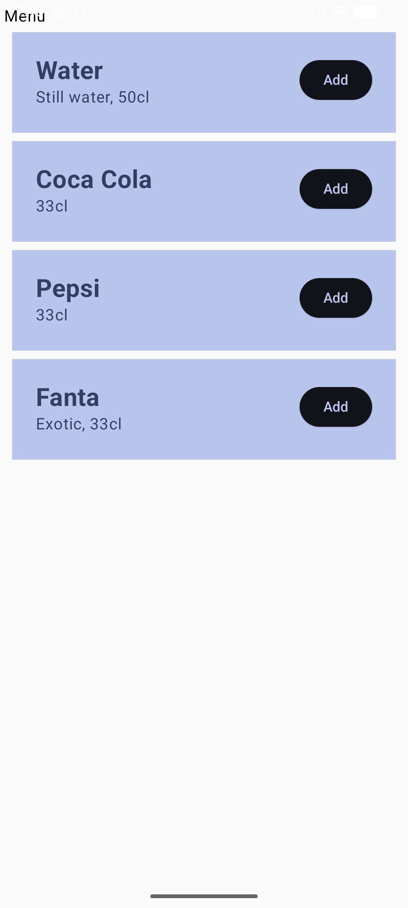

# Android Development: Lab 1

Menu List Android Application

## Screenshots

## Requirements & Setup

### Prerequisites
* **Android Studio** Rabbit 1 (or newer)
* **Android SDK** Level 37 (API 37)
* **Gradle** Version 9.6.0
* **Minimum Android SDK Supported** API 24 (Android 7.0)

### Installation
1. Clone the repository
2. Open the project in **Android Studio**.
3. Sync the project with **Gradle Files**.
4. Run the app on an **Emulator** or a physical device.
